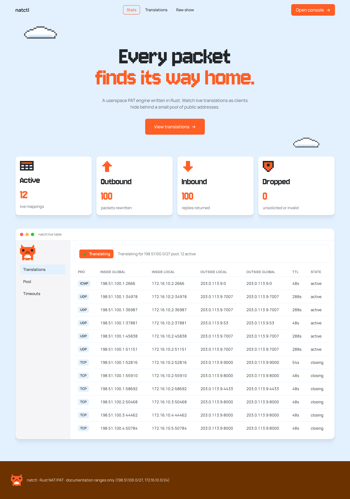
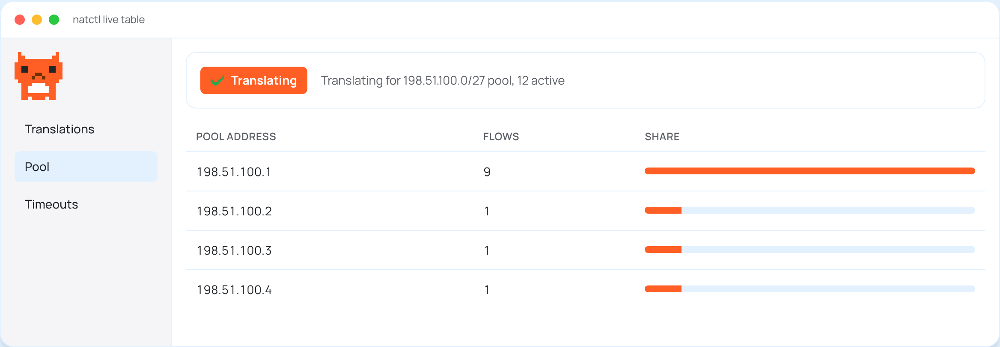

# Networth

[](https://github.com/patilrajvardhan27/Networth/actions/workflows/ci.yml)

A stateful NAT/PAT router written in Rust, running in userspace over Linux TUN devices. It is inspired by a university enterprise networks lab and re-implements the behavior only: pool-based port address translation, a first-match ACL that exempts inside-to-inside traffic, stateful inbound filtering, MSS clamping and active/standby failover that keeps established TCP flows alive.

All addresses are RFC 5737 documentation ranges (`198.51.100.0/27` pool, `172.16.10.0/24` inside, `203.0.113.0/24` outside).



## Layout

```
crates/
  packet/     hand-written IPv4/IPv6/TCP/UDP/ICMP parsing, RFC 1624 checksum patching, MSS clamp (no dependencies)
  nat-core/   pure state machine: PAT pool, forward/reverse maps, BTreeSet expiry, ACL, TCP state filter, injected clock
  nat-sync/   UDP replication of table deltas between an active and a standby instance
  natctl/     tokio binary: two TUN devices, admin HTTP console, `natctl show`
  dnsfwd/     UDP DNS forwarder with a TTL cache (hickory-proto for parsing)
  tlsprobe/   rustls client used to prove TLS survives the NAT
dashboard/    pixel-art console served by natctl (plain HTML, CSS and JS)
scripts/      network namespace topology, integration suite, demo and screenshot capture
fixtures/     shared addresses and ports for every script
fuzz/         cargo-fuzz target for the parser with a seed corpus
```

## Lab feature to module

| Behavior | Module | Detail |
|---|---|---|
| Pool-based port address translation with overload | `nat-core::pat` | Keep the source port when free, otherwise take the next free one in the same port block; each inside host sticks to one pool address |
| Exempting inside-to-inside traffic from translation | `nat-core::acl` | First-match ACL evaluated before translation, no match means no translation |
| Established flows surviving a router failover | `nat-sync` | Standby applies replicated deltas; kill the active and the stream completes |
| TCP MSS clamping | `packet::mss` | Clamp on SYN with an incremental checksum update |
| Stateful inbound filtering | `nat-core::reflect` | Outside hosts cannot initiate or revive a TCP flow |
| Listing the translation table | `natctl show` | Protocol, inside global, inside local, outside local, outside global |

## Architecture

```
 ns-client ──► kernel ──► in0 ──► natctl (outbound) ──► out0 ──► kernel ──► ns-server
 ns-client ◄── kernel ◄── in0 ◄── natctl (inbound)  ◄── out0 ◄── kernel ◄── ns-server
                                     │
                         nat-core: Table (fwd + rev maps, deadlines)
                                     │ deltas over UDP
                                     ▼
                              standby natctl
```

Outbound packets are routed to `in0`, rewritten, and written to `out0`. A route for the pool prefix points at `out0`, so replies return through `natctl` and are reverse-translated onto `in0`. Policy routing (`ip rule iif out0`) keeps translated packets from looping.

## Run it

Needs Linux with TUN support, root, and `iproute2`, `ethtool`, `openssl`, `curl`, `python3`.

```bash
cargo build
sudo scripts/it.sh        # full namespace suite
sudo scripts/demo.sh      # live demo, console at http://192.0.2.22:8080
```

Standalone:

```bash
sudo target/debug/natctl run --pool 198.51.100.0/27 \
  --acl "deny 172.16.0.0/16 172.16.0.0/16" --acl "permit 172.16.10.0/24 any" --mss 1400
target/debug/natctl show
```

Docker (the console listens on the container address and is published on the host loopback only):

```bash
docker build -t natctl .
docker run --cap-add=NET_ADMIN --device /dev/net/tun -p 127.0.0.1:8080:8080 natctl run --admin 0.0.0.0:8080
```



## Testing

| Layer | What it checks |
|---|---|
| Unit | Translation table, port allocation, expiry, pool exhaustion, ACL order, TCP state |
| `proptest` | Incremental checksums equal a full recompute after rewriting addresses and ports; `etherparse` acts as an independent oracle; arbitrary bytes never panic the parser |
| Netns integration | curl, UDP echo, ping, rustls handshake and a DNS query through the NAT, plus a mid-transfer failover |
| Failover control | The same failover with replication disabled fails, so the pass is not accidental |
| `cargo-fuzz` | `fuzz/` target and seed corpus, run locally on nightly (`cargo +nightly fuzz run parse`), not in CI |
| CI | `cargo fmt --check`, `clippy -D warnings`, `cargo test`, `cargo-deny`, namespace job under `sudo`, Docker build |

## Benchmark

`cargo bench -p nat-core` on one core of a cloud VM, translation function only (no TUN I/O, 512 byte TCP payload copied per iteration):

| Case | Time | Throughput |
|---|---|---|
| TCP outbound, established | 141 ns | 7.1 Mpps |
| TCP inbound, established | 135 ns | 7.4 Mpps |
| UDP outbound, established | 132 ns | 7.6 Mpps |

End-to-end throughput through TUN devices is bounded by syscalls and was not benchmarked.

## Limitations

- No ALGs (FTP, SIP and similar payload rewriting).
- No fragment reassembly; fragments are dropped.
- ICMP is translated for echo only; ICMP error messages are not translated.
- IPv4 only for translation; NAT64 is not implemented. The IPv6 parser is read-only.
- Default timeouts (TCP 86400 s, UDP 300 s, DNS/SYN/FIN-RST/ICMP 60 s) follow common IOS defaults and should be checked against the vendor docs.
- Replication is best effort UDP with a 200 ms beat; a flow created within the last beat before a failover can be lost.
- The admin console is unauthenticated and read-only; it binds to loopback by default.

## Credits

Fonts: Jersey 10 and Manrope, both SIL Open Font License, bundled in `dashboard/fonts`.
